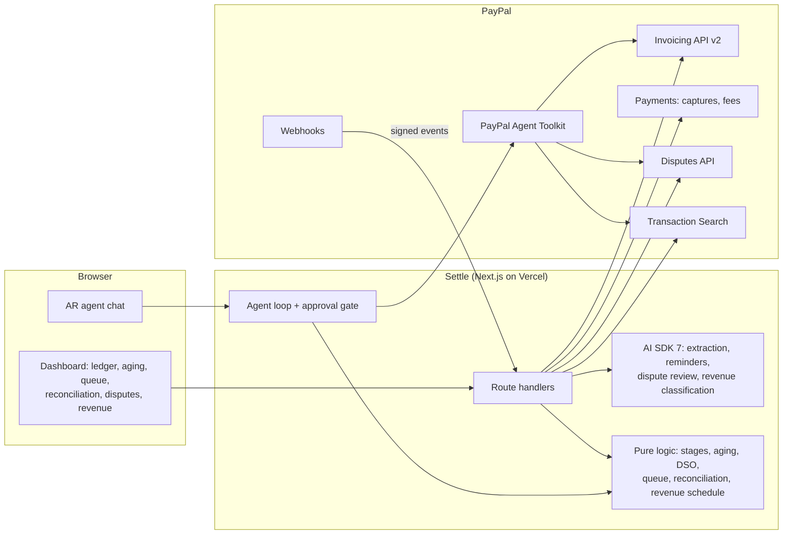

# Settle: AI accounts receivable on PayPal

**Live demo:** https://paypalsettle.revexos.com (PayPal sandbox, no real money)

Small businesses wait weeks to get paid because invoicing, chasing and matching payments are manual. Settle runs
the quote-to-cash loop on PayPal with AI doing the busywork and a human approving anything that touches money.

1. **Quote to invoice.** Paste a scope, quote, PO or email thread. AI extracts the customer, line items, terms
   and PO reference, flags anything ambiguous, and you create and send a PayPal invoice in one click.
2. **Receivables.** A live ledger of every PayPal invoice: balance, due date, days late, collection stage, and
   whether the customer has opened it. Above it: outstanding, overdue, DSO and an aging chart (Current, 1-30,
   31-60, 61-90, 90+).
3. **Collections.** Today's queue ranks who to chase by balance x lateness (unopened invoices first, since they
   were probably missed) and skips anyone reminded in the last 5 days. AI drafts each reminder with a tone that
   escalates with lateness (friendly, neutral, firm, final) and adapts to partial payments. You approve each one
   and it goes out through PayPal's reminder API.
4. **Reconciliation.** Every payment matched to its invoice, with PayPal fees (from the capture) and net to bank.
   A small gap after payment is a short pay (bank or FX charges): one click invoices the balance and closes the
   original. A bigger gap is a partial payment and stays in collections. With Transaction Search enabled, PayPal
   receipts that aren't tied to any invoice show up as unapplied cash.
5. **Disputes.** When a customer disputes an invoice payment, AI reads the claim and the invoice behind it,
   recommends accept, partial refund or contest, and drafts the evidence and the message to the buyer. You edit
   and send it through the Disputes API.
6. **Revenue recognition (ASC 606 / IFRS 15).** AI reads every PayPal invoice line and decides whether it is
   earned at a point in time (a build, a design, hours already worked) or over a service period (hosting, a
   subscription, a retainer), with the period and a reason. A monthly waterfall shows billed, collected, recognized,
   deferred and unbilled revenue. Full months get equal amounts and partial months are split by their days. Edit any
   line, download the schedule as CSV.
7. **AR agent.** Ask "who should I chase today?", "any short pays?" or "remind everyone more than 14 days late".
   The agent uses the PayPal Agent Toolkit to read invoices, transactions and disputes, plus Settle's own tools for
   AR health, reconciliation and the revenue schedule. Any write (send, remind, record payment, cancel) pauses for
   your approval, and approvals are signed server-side.
8. **Live updates.** PayPal webhooks (invoice paid, cancelled, refunded; dispute created, updated, resolved) are
   signature-checked and shown in a live feed, and the ledger refreshes when one arrives.

## How it fits together



Money-moving decisions stay deterministic (stages, aging, short-pay rules, the revenue math) and AI does the
reading and writing around them. Every write to PayPal is a click by a human: a button in the UI, or an approval
card in the agent chat.

## PayPal and AI used

| Piece | Where |
|---|---|
| PayPal Invoicing API v2 (create, send, remind, record payment, cancel, list) | `lib/paypal.ts` |
| PayPal Payments (capture fee and net), Transaction Search, Disputes, Webhooks | `lib/paypal.ts`, `lib/reconcile.ts`, `lib/disputes.ts`, `app/api/webhooks` |
| PayPal Agent Toolkit (`@paypal/agent-toolkit`): invoices, transactions, insights, disputes, orders | `lib/agent-tools.ts`, `app/api/agent` |
| AI SDK 7 structured output for extraction, reminders, dispute review | `lib/extract.ts`, `lib/reminder.ts`, `lib/disputes.ts` |
| AI SDK 7 tool loop with human approval | `app/api/agent/route.ts`, `components/AgentChat.tsx` |
| AG Grid receivables ledger and editable obligations grid | `components/Ledger.tsx`, `components/RevRec.tsx` |
| Collection stages, aging, DSO, collections queue | `lib/ar.ts` |
| Revenue schedule math (pure, tested by hand against known cases) | `lib/revrec.ts` |
| AI line classification for revenue recognition | `lib/revrec-classify.ts` |
| Demo data: 10 invoices across every stage, with partial, short and full payments | `lib/seed.ts` |

The toolkit's AI SDK adapter targets AI SDK v4; `lib/agent-tools.ts` re-wraps its tools for v7.

## Run it

```
cp .env.example .env.local   # add PayPal sandbox client id/secret and an OpenAI key
npm install
npm run dev
```

Click **Reset demo data** for a realistic book of 10 invoices (pre-due through 37 days late, one partial payment,
one short pay, three paid). Reset only touches the invoices it created.

Webhooks: register `https://<your-host>/api/webhooks/paypal` on the PayPal app for the invoice and dispute events
and set `PAYPAL_WEBHOOK_ID`. Unapplied cash needs **Transaction Search** enabled on the app.

Sandbox buyers: use **US** Personal accounts as customers (PayPal blocks sending invoices to recipients in India). Create them under Testing Tools > Sandbox Accounts. Log in at sandbox.paypal.com as the buyer to pay an invoice.

## License

MIT
